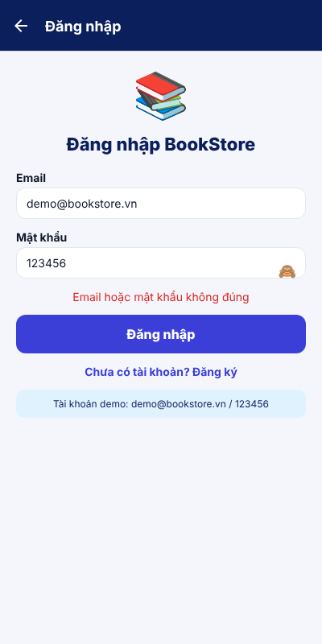

# Trả lời câu hỏi bổ sung – Buổi 8

**1. Cờ `ready`.**
Nếu bỏ điều kiện `ready`, ngay lần render đầu tiên `cartItems` còn là mảng rỗng (dữ liệu cũ trong AsyncStorage chưa kịp đọc, vì việc đọc là bất đồng bộ). Effect của `useAutoPersist` chạy sau lần render đó và ghi `[]` đè lên giỏ hàng đã lưu. Khi `usePersistence` đọc xong thì dữ liệu cũ đã mất, nên mở lại app giỏ luôn trống. Thứ tự: render 1 (giỏ rỗng) → effect ghi `[]` → đọc storage (đã bị ghi đè) → dispatch `hydrateCart` với dữ liệu rỗng. Cờ `ready` chỉ bật sau khi đọc xong nên chặn được việc ghi sớm này.

**2. Token giả.**
Hai điểm không an toàn: (1) app tự tải user từ json-server rồi tự so mật khẩu ở phía client, nghĩa là mật khẩu (dạng thô) nằm trong dữ liệu mà ai gọi API cũng đọc được; (2) token do app tự tạo nên không có chữ ký, không hết hạn và server không xác minh được, ai cũng có thể làm giả. Hệ thống thật để **server** kiểm tra mật khẩu (băm bằng bcrypt/argon2, không lưu mật khẩu thô) và cấp token (JWT có chữ ký, có hạn). Token nên lưu ở kho an toàn của hệ điều hành: `expo-secure-store` (Keychain trên iOS, Keystore trên Android) thay cho AsyncStorage vốn chỉ là văn bản thuần, không mã hóa. Trên web dùng cookie `HttpOnly`.

**3. Hai effect trong `CartItemRow`.**
Nếu xóa effect đồng bộ `setQty(item.quantity)` thì `qty` chỉ được khởi tạo một lần từ `item.quantity`. Số hiển thị sẽ lệch store khi store đổi từ nơi khác mà component không bị tạo lại, ví dụ: bấm "Thêm vào giỏ" cùng cuốn sách ở nơi khác (store tăng số lượng), hoặc `clear()`/hydrate lại giỏ từ AsyncStorage sau khi dòng đã render. Khi đó store có số mới nhưng nút vẫn hiện số cũ, và nếu người dùng bấm +/− thì số cũ lại bị đẩy ngược lên store, làm mất thay đổi kia.

**4. Một nguồn state.**
Nếu mỗi `HeartButton` giữ `useState` riêng thì trạng thái tim là bản sao độc lập theo từng component: thả tim ở lưới sách thì trang Chi tiết (một instance khác) vẫn là ♡, mở lại màn hình hoặc tải lại app thì mất hết, và màn Yêu thích cũng không biết sách nào đã thích. Với store, trạng thái chỉ nằm ở một chỗ (`wishlist.ids`); mọi nơi đọc qua `isFavorite(id)` và ghi qua `toggle(id)`, nên khi store đổi tất cả component đang dùng nó render lại cùng lúc và luôn khớp nhau. Store cũng là chỗ duy nhất cần lưu vào AsyncStorage.

**5. Hiện/ẩn mật khẩu.**
Code trong `src/screens/LoginScreen.tsx`:

```tsx
const [showPassword, setShowPassword] = useState(false);

<View style={styles.passwordWrap}>
  <FormField label="Mật khẩu" value={password} onChangeText={setPassword}
    error={errors.password} secureTextEntry={!showPassword} />
  <Pressable style={styles.eye} onPress={() => setShowPassword((v) => !v)}
    accessibilityLabel={showPassword ? "Ẩn mật khẩu" : "Hiện mật khẩu"}>
    <Text style={styles.eyeText}>{showPassword ? "🙈" : "👁"}</Text>
  </Pressable>
</View>
```

Ảnh chụp màn hình (đã bấm hiện mật khẩu, thấy `123456`): `docs/cau5_hien_mat_khau.png`


